  
  
  
  
  
  
  

  

# 🚀 Awesome Enterprise SLA & Support Service Management

### 🌟 Curated List of SaaS Platforms & Self-Hosted Open-Source ITSM Solutions
*Empowering ITIL Service Delivery, Multi-Tier SLA Tracking, CMDB Asset Discovery & Ticket Orchestration*  
**Updated: 2026 Edition**

---

Welcome to the definitive, SEO-optimized directory of **Enterprise SLA (Service Level Agreement) and Support Service Management** platforms. Whether designing high-availability IT support operations, evaluating enterprise ITIL 4 service desk architectures, or deploying sovereign open-source ticketing platforms without per-agent licensing fees, this ecosystem guide provides benchmarks for SaaS vendors and self-hosted open-source GitHub repositories.

Key capabilities tracked across this list include **automated SLA breach escalations**, **dynamic business hours calculation**, **incident/problem/change management (ITSM)**, **Configuration Management Databases (CMDB)**, and **AI-driven ticket summarization and deflection**.

---

## 📑 Table of Contents
- [📊 Sector Overview & Market Dynamics](#-sector-overview--market-dynamics)
- [☁️ SaaS & Hosted Enterprise Platforms](#️-saas--hosted-enterprise-platforms)
- [🔓 Open-Source GitHub Projects](#-open-source-github-projects)
  - [⭐ Verified Open-Source Leaders (Sorted by Stars)](#-verified-open-source-leaders-sorted-by-stars)
- [🤝 How to Contribute](#-how-to-contribute)
- [💖 Support & Sponsorship](#-support--sponsorship)
- [📈 Star History](#-star-history)
- [⚖️ Disclaimer](#️-disclaimer)

---

## 📊 Sector Overview & Market Dynamics

The global IT Service Management (ITSM) and enterprise support services market is valued at **$14.8B to $17.6B in 2026** (projected at an estimated ~14%–16% CAGR from ~$13B in 2025). The industry demonstrates a **moderately fragmented, tier-concentrated market dynamic**:

- **Top-Tier Enterprise Concentration:** Heavyweight enterprise platforms (led by ServiceNow with ~$105B market cap, alongside Atlassian Jira Service Management and BMC Helix) capture the lion's share of Fortune 500 ITIL transformations, complex CMDB discovery, and enterprise service management (ESM).
- **Vibrant Mid-Market & Open-Source Fragmentation:** An extensive and growing long-tail of agile SaaS providers (Freshservice, SolarWinds, SysAid) and self-hosted open-source tools (Chatwoot, UVdesk, GLPI, Zammad, Frappe Helpdesk, Libredesk, iTop) satisfy SMBs, developer-centric organizations, and privacy-conscious enterprises demanding compliance, custom workflows, and data sovereignty.

---

## ☁️ SaaS & Hosted Enterprise Platforms

| Product | Company Scale (Revenue / Valuation) | Pricing (Starting Tier) | Free Tier / Trial Limits | Description |
|:---|:---|:---|:---|:---|
| **[ServiceNow](https://www.servicenow.com/)** | **~$105B Market Cap** (~$15.4B TTM Revenue) | **$70/fulfiller/month** (Foundation/Standard entry tier, billed annually; quote-based) | **Free Personal Developer Instance (PDI)**: 1 developer instance, non-production; requires login every 10 days or reclaimed after 90 days of age | The enterprise ITIL benchmark. Full lifecycle coverage including CMDB discovery, incident/problem/change practices, virtual agents, and predictive AIOps. |
| **[Jira Service Management](https://www.atlassian.com/software/jira/service-management)** | **~$37B Market Cap** (~$6.6B TTM Revenue) | **$20/agent/month** (Standard plan; $25/agent/month on monthly billing) | **Free forever plan**: Up to 3 agents, unlimited customer requestors, 2 GB file storage, 100 email notifications/day (also offers a 14-day free trial for Standard/Premium tiers) | Deeply unified with Jira Software and Confluence. Features customizable SLA engines, incident swarming, change calendar automation, and Atlassian Rovo AI. |
| **[SolarWinds Service Desk](https://www.solarwinds.com/)** | **~$3.2B Market Cap** (~$797M TTM Revenue) | **$39/technician/month** (Essentials plan, billed annually) | **30-day free trial**: Full access to Premier tier features, ITAM/CMDB capabilities, unlimited ticket requestors, no credit card required | Streamlined ITIL service desk software providing real-time SLA breach risks, hardware/software inventory discovery, and employee self-service. |
| **[Freshservice](https://www.freshworks.com/freshservice/)** | **~$3.2B Market Cap** (~$903M TTM Revenue) | **$19/agent/month** (Starter plan billed annually, or $29/month-to-month; Growth tier with full SLA management starts at $49/agent/month) | **14-day free trial**: Unrestricted access to Enterprise features, unlimited agents during evaluation, no credit card required | Modern cloud ITSM powered by Freddy AI. Combines multi-department service catalogs, automated incident routing, contract management, and SLA timelines. |
| **[BMC Helix](https://www.bmc.com/)** | **~$2.2B Annual Revenue** (Private, owned by KKR) | **$115/named user/month** (Entry Service Desk tier via enterprise quote/G-Cloud frameworks) | **30-day enterprise Proof of Concept (PoC) / custom guided trial**: Scoped dedicated environment upon sales request, plus interactive on-demand sandbox demos (no self-serve free forever plan) | Enterprise-grade ServiceOps and ITIL automation suite featuring HelixGPT, multi-cloud discovery, automated root-cause detection, and business workflow orchestration. |
| **[SysAid](https://www.sysaid.com/)** | **~$30M ARR** (Private, raised $30M from IGP) | **$89/agent/month** (Professional AI plan, billed annually) | **30-day free trial**: Full feature access to AI agents, asset discovery, and ticket management workflows, no credit card required | Generative AI-native IT service desk offering zero-trust cross-department data segregation, one-click asset tracking, and proactive SLA escalation rules. |

---

## 🔓 Open-Source GitHub Projects

Self-hosted and open-source ITSM and customer support platforms offer zero per-seat licensing penalties, full data sovereignty, and unconstrained compliance auditing.

### ⭐ Verified Open-Source Leaders (Sorted by Stars)

| Project | Stars_Badge | Stack / Architecture | Core SLA & Service Management Features |
|:---|:---:|:---|:---|
| **[Chatwoot](https://github.com/chatwoot/chatwoot)** |  | Ruby on Rails, Vue.js, PostgreSQL, Redis | **Omnichannel customer engagement & support platform.** Built-in SLA policies, response time tracking, multi-brand customer inboxes, live chat, and webhook automation. |
| **[UVdesk](https://github.com/uvdesk/community-skeleton)** |  | PHP (Symfony), MySQL | **Enterprise open-source helpdesk system.** Extensible ticketing workflow, SLA policies with automated escalations, custom ticket types, and multi-channel email integration. |
| **[GLPI](https://github.com/glpi-project/glpi)** |  | PHP, MariaDB / MySQL | **The complete open-source ITIL service desk & CMDB.** Used by 100,000+ organizations. Full incident, request, problem, and change management; SLA/OLA tracking with escalation triggers; agentless network asset discovery. |
| **[Zammad](https://github.com/zammad/zammad)** |  | Ruby, Elasticsearch, PostgreSQL | **Modern web-based open-source support desk.** Precision SLA management with custom working calendars, multi-channel intake, real-time ticket collisions detection, and audit logging. |
| **[FreeScout](https://github.com/freescout-help-desk/freescout)** |  | PHP (Laravel), MySQL | **Lightweight self-hosted helpdesk & shared mailbox.** Zero seat fees, modular module architecture, SLA tracking modules, auto-responders, and full multi-lingual support. |
| **[osTicket](https://github.com/osTicket/osTicket)** |  | PHP, MySQL | **Battle-tested open-source support ticket system.** Features flexible SLA plans, automatic ticket routing, ticket filter rules, custom form fields, and customer portal. |
| **[Frappe Helpdesk](https://github.com/frappe/helpdesk)** |  | Python (Frappe), Vue.js, MariaDB | **Modern open-source service platform with SLA tracking.** Clean UI, automated ticket routing, customer synchronization with ERPNext, and unlimited agents without licensing overhead. |
| **[Libredesk](https://github.com/abhinavxd/libredesk)** |  | Go, Single Binary | **Ultra-lightweight support desk with SLA breach monitoring.** Real-time warning triggers for impending SLA deadlines, low memory footprint, and embedded AI response assistants. |
| **[Trudesk](https://github.com/polonel/trudesk)** |  | Node.js, MongoDB, Elasticsearch | **Open-source helpdesk and service ticketing system.** Real-time ticket updates via WebSockets, SLA notifications, custom reporting dashboards, and role-based permissions. |
| **[iTop](https://github.com/Combodo/iTop)** |  | PHP, MySQL | **Complete ITIL-compliant Service Management & CMDB solution.** Interactive service catalog, customer contract tracking, SLA definitions by customer/service tier, and change management. |
| **[Znuny](https://github.com/znuny/Znuny)** |  | Perl, PostgreSQL / MariaDB | **Audit-proof open-source ticket management (LTS fork of OTRS CE).** Immutable communication histories for compliance, SLA time tracking, process ticket management, and SAML authentication. |
| **[OTOBO](https://github.com/rotheross/otobo)** |  | Perl, Elasticsearch, MariaDB | **Enterprise open-source ITSM platform forked from OTRS.** Free included CMDB, dynamic service catalog, ITIL process management, and SLA escalation workflows. |
| **[heidsoft/itsm](https://github.com/heidsoft/itsm)** |  | Go / Java, BPMN Engine, Vue.js | **AI-native open-source ITSM platform with BPMN orchestration.** Native ITIL processes, SLA engines, CMDB topology, and embedded triage AI assistance. |

---

## 🤝 How to Contribute

Contributions to this ecosystem guide are warmly welcomed! 🛠️

1. 🍴 **Fork** the repository.
2. 🌿 Create a new feature branch (`git checkout -b feature/new-itsm-platform`).
3. 📝 Add or edit entries in `README.md` following the established table formats (ensure accurate pricing, SLA features, and stargazers link formatting).
4. 🚀 Submit a **Pull Request** with a concise description of the platform's merits.

---

## 💖 Support & Sponsorship

Thank you for visiting and using this curated resource! If you find this repository helpful for your engineering, support operations, or ITIL implementation:

- ⭐ **Star this repository** to help others discover it!
- 🍴 **Fork and share** it with your DevOps and IT operations colleagues.
- ☕ If this project saved you hours of research or software evaluation, consider supporting ongoing curation:

  

---

## 📈 Star History

---

## ⚖️ Disclaimer

- This list is **community-curated** for architectural comparison and research purposes; it does not constitute commercial endorsement.
- Enterprise SLA and support service management software systems store sensitive corporate data, employee PII, and infrastructure configurations. Always establish proper role-based access control (RBAC), end-to-end encryption, and regulatory compliance standards (GDPR, SOC 2, HIPAA) when deploying cloud or self-hosted solutions.

---

  Built with ❤️ for IT Service Managers, DevOps Engineers, and Support Operations Leaders worldwide.

